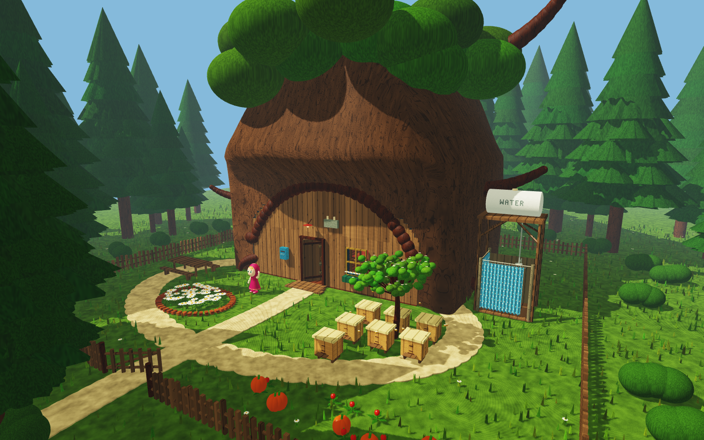
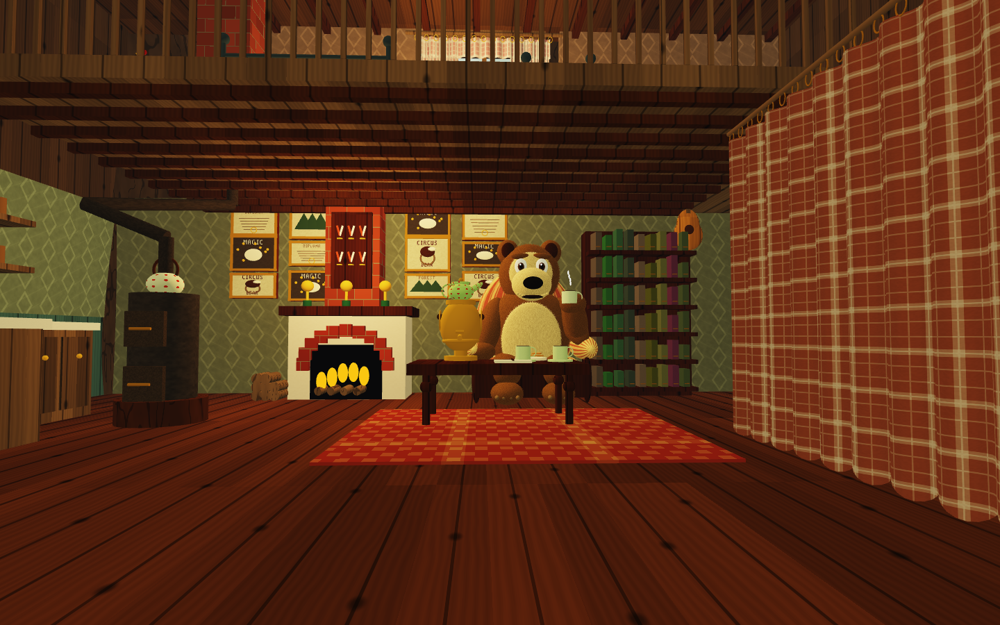
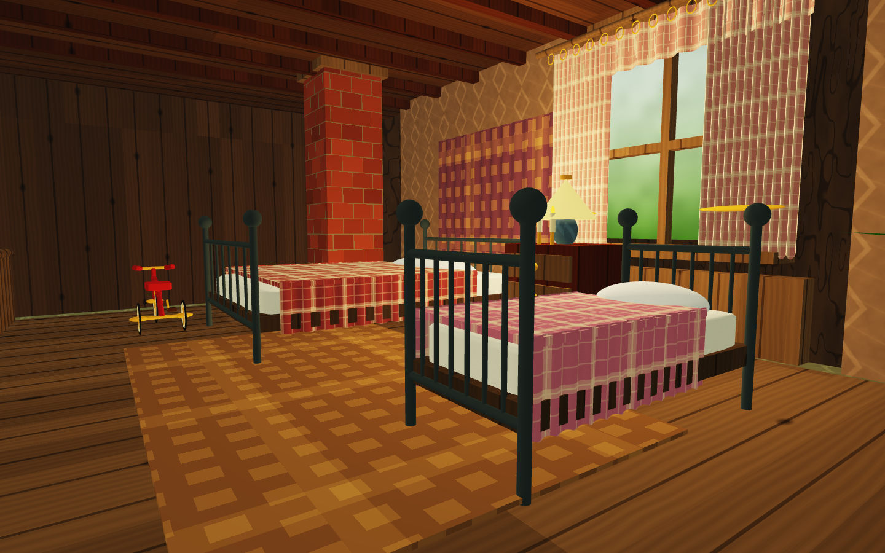

# Masha and the Bear A Forest Home

A C++17 and OpenGL 3.3 walkthrough inspired by Bear's forest home. Built for Computer Graphics Fundamentals by **Akerke Kuan and Nurai Nariman**.



## Download and run on Windows

Download [Forest_Home_Windows_x64.zip](Forest_Home_Windows_x64.zip?raw=true). Extract the complete archive, then double-click **Run_ForestHome.cmd**. No Visual Studio installation is needed for the included executable. Keep the shader files next to the executable. Windows x64 and a working OpenGL 3.3 graphics driver are required.

## Explore

Press Enter to start. WASD moves, the mouse or arrow keys look around, Shift moves faster, and Escape releases the mouse. E near the front door opens or closes it.

Keys 1–9 select viewpoints. Key 0 shows Bear close up. N switches day/night, L toggles shadows, T toggles procedural materials, H toggles help, and F9 starts a four-minute guided tour.

The yard includes a fence, flowers, an apiary, vegetables and a shower. Inside are a furnished lounge, kitchen and an upstairs bedroom reached by curved stairs. Masha and Bear are original stylised procedural models.



## Full project and source code

[Download the full project](Forest_Home_Full_Project.zip?raw=true). It contains the complete C++ source, shaders, tests, vendored libraries, executable and the final report. Extract it and open the final_gra folder.

The full source is packaged as an archive because this repository was uploaded through GitHub's browser interface. The CMake file at the repository root also extracts the exact source archive into the build directory automatically, so a clone or GitHub source download can be built directly.

## Build from source offline

Install Visual Studio 2022 or 2026 with Desktop development with C++, Windows SDK and CMake tools. GLFW, GLEW and GLM sources are included. Configuration performs no network fetch.

Open this folder in Visual Studio and select the matching preset, or run:

```powershell
./build.ps1
# Visual Studio 2026
./build.ps1 -Generator 'Visual Studio 18 2026'
```

For a command-line Visual Studio 2022 build with regression checks:

```powershell
cmake -S . -B out/manual -G 'Visual Studio 17 2022' -A x64
cmake --build out/manual --config Release -- /m:1 /nr:false
ctest --test-dir out/manual -C Release --output-on-failure
cd out/manual/bin/Release
./ForestHome.exe --verify-navigation
```

## Rendering

The scene uses indexed and instanced meshes, model/view/projection transforms, GLSL materials, directional and local lighting, 2048Г—2048 filtered shadow mapping, tone mapping and time-based animation. Static transforms are cached and distant forest trees use reduced geometry.

A 20-second VSync-off Release measurement at the welcome viewpoint averaged about 29.9 FPS at 1440Г—900 on AMD Radeon (TM) Graphics with 4Г— MSAA and shadows enabled, with zero OpenGL errors. Performance varies with viewpoint and hardware.



## Credits and AI use

Read [AI_USE.md](AI_USE.md) and [THIRD_PARTY_NOTICES.md](THIRD_PARTY_NOTICES.md). Codex assisted with code, GLSL, procedural assets and documentation. The project uses original geometry and shader patterns, rather than extracted cartoon models or textures. Character names and visual inspiration belong to their respective rights holders, including Animaccord. Dependency source licences are retained in third_party. No broad licence to the character IP is claimed.
